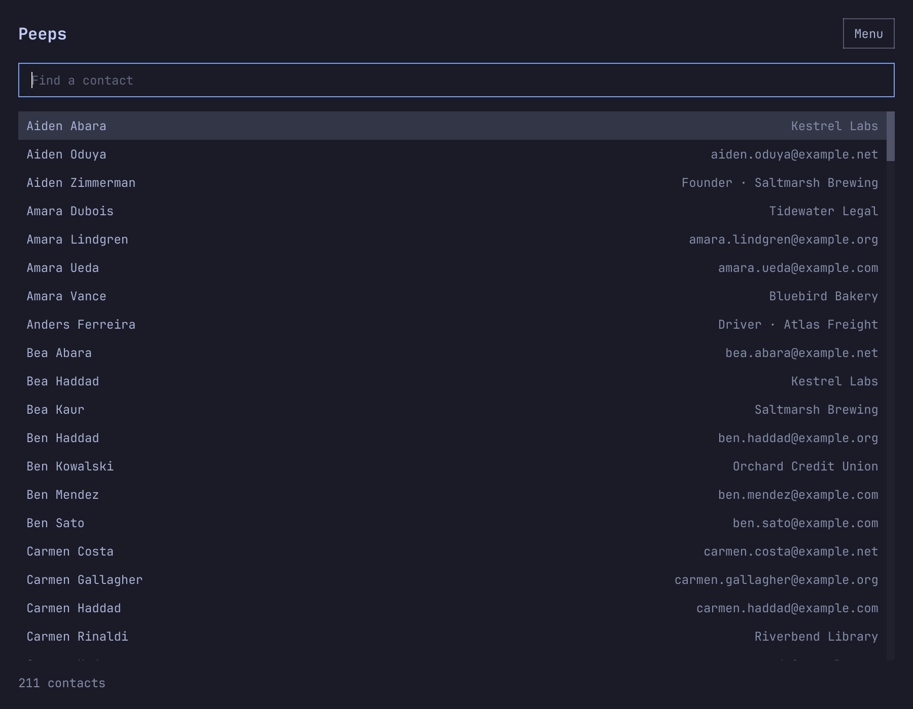
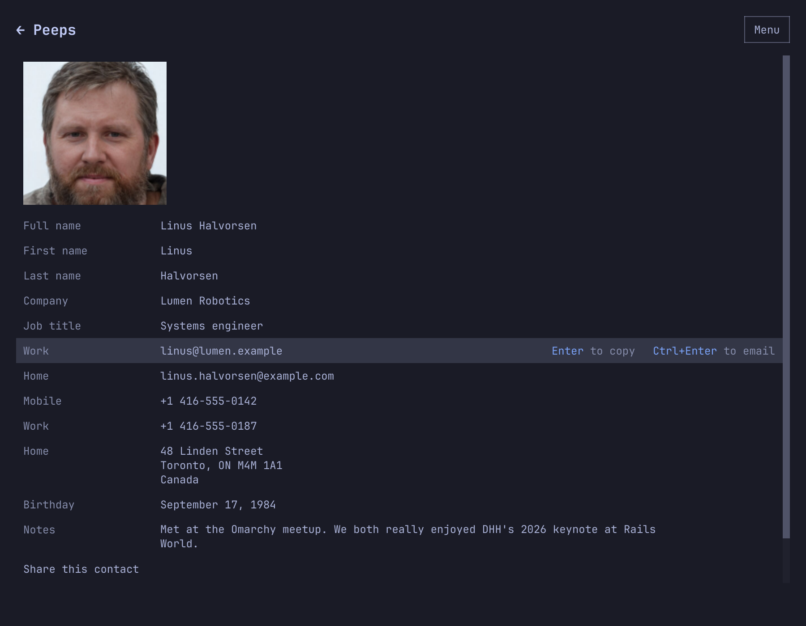

# Peeps

A keyboard-first address book for Omarchy, for the contacts you keep in Google.

- **Instant search.** Peeps searches a copy of your contacts on this computer, so finding someone never waits on the network.
- **The same book on your phone.** Edits go straight to Google, so they show up on an iPhone, an Android phone, or a Mac that uses Google Contacts.
- **At home in Omarchy.** It takes the current theme, text size, and font, and follows them when they change.
- **Keyboard first, and scriptable.** Search, copy, and email without the mouse. The `peeps` command lists, searches, and edits the same contacts, with JSON for scripts, and a [skill](#agents) teaches AI agents to use it.

Your contacts travel only between this computer and Google. There is no Peeps server, and no analytics or tracking. The [privacy policy](https://omelia.org/peeps/privacy) has the details.



## Why Peeps

My family came to Omarchy from Macs. We all have iPhones, and our contacts lived in iCloud. After the switch we still wanted one address book that we could read and edit on the phones and on the Omarchy desktop. Google Contacts made the most sense as the place for it: an iPhone syncs with it from Settings, Android uses it already, and it has a real API. That left us needing an Omarchy app for Google Contacts, and Peeps is that app.

## Is this for you?

It fits if you want these things:

- Google is where the contacts live, and the window is just a fast way to use them. The same book shows up on an iPhone, a Mac, or an Android phone that uses Google Contacts, so a change here or there stays in sync.
- Search, copy, and mail should work from the keyboard, including while the search field is focused.
- The window should follow Omarchy: `colors.toml` when you change themes, the text size from the Omarchy menu, and the monospace font from `omarchy font set`.
- Mail should open in whatever owns `mailto:` on the machine. On a stock Omarchy desktop that is the HEY app.
- An agent should be able to inspect and edit the book from the shell, with JSON on a pipe, without a private API.

It is one Google account, not a CRM. Lookups and the contact you are reading come from the cache. Creating, editing, deleting, and sync go to Google and then refresh that cache. A delete from the command line requires `--yes`.

## Agents

Peeps comes with a skill for AI agents such as Claude Code, Codex, and pi. A skill is a page of instructions an agent reads when a request matches it. This one teaches the `peeps` command and how to use it with care.

When Peeps opens, it links the skill into the skills folder of each agent set up on the machine (`~/.claude`, `~/.codex`, `~/.pi/agent`, and `~/.agents`), the same way Omarchy shares its own skills, and says so the first time. `peeps skill remove` takes the links away and keeps Peeps from adding them back. `peeps skill install` brings them back.

Then ask in plain words:

- "Add the person from this email signature."
- "What's Maya Okafor's work number?"
- "Who do I know at Northwind, and whose birthday is this month?"
- "Put every phone number in the +1 format."

Every add, edit, or delete is confirmed first. Asking for a change is not agreeing to it: the agent looks the person up, says exactly what will change, including any label or other choice it would make, and changes nothing until you say yes. Looking people up needs no confirmation. The skill is instructions the agent follows, so for a hard guarantee, have your agent ask permission before it runs `peeps add`, `peeps update`, or `peeps delete`. In Claude Code, that is an `ask` rule in its permission settings.

The agent also keeps what it reads to the people the request is about. What it reads goes into that conversation, and so to the agent's AI provider. Peeps itself still talks only to Google.

## The window

Type to search. Up and Down move through the matches, including while the search field still has focus. Typing anywhere in the list starts a new search. Enter opens the contact. On a contact, letters don't search: Up and Down, or j and k, move through the fields, g and G jump to the first and last, and `/` goes back to search. Enter on a field copies it. Ctrl+Enter sends mail to the selected address through `xdg-email`, which follows the desktop mail handler. The selected field names these keys, as in "Enter to copy" and "Ctrl+Enter to email", until you have used each one ten times from the keyboard.

Esc or Backspace returns to the list, or clears the search if that is where you are. The footer counts the contacts, and says when Peeps last synced with Google if that was over an hour ago. `?` opens the keybindings. Ctrl+N starts a contact and Ctrl+E edits the one you are on. New, Sync, Keybindings, and Google account are in the Menu.

The mouse works too. One click opens a contact. One click on a field copies it, and one click on Share, Edit, or Delete this contact does that. While a contact is open, the title reads "← Peeps", and clicking it, or a mouse's back button, returns to the list.

Launching Peeps again brings the open window forward instead of opening a second one, from the app launcher or the terminal alike. Its window class (the Wayland app id) is `org.omelia.Peeps`.



| Keys | Action |
| --- | --- |
| Type | Search names, email, phone, and notes |
| Up / Down | Move through matches or fields |
| j / k | Move through fields on a contact |
| g / G | First or last field on a contact |
| `/` | Search, from the list or a contact |
| Enter | Open the contact, or copy the selected field |
| Super+C | Copy the selected field. Omarchy delivers this as Ctrl+C |
| Ctrl+Enter | Email the selected address |
| Esc or Backspace | Back to the list, or clear the search |
| `?` | Keybindings |
| Ctrl+N / Ctrl+E | New contact, edit the selected contact |
| Ctrl+S | Save the open contact |
| Ctrl+= / Ctrl+- | Larger or smaller text than Omarchy's |
| Ctrl+0 | Back to Omarchy's text size |

Copying a field names it. A birthday says "Copied birthday". A work address says "Copied work email".

### Editing

The editor groups fields the way people look for them. The photo sits beside first name, last name, company, and job title. Email, phone, address, and notes follow, each under its own heading with a `+ Add` line beneath. Nickname, birthday, websites, related people, other companies, and custom fields wait behind More fields, which opens by itself when a contact already has one of them.

Tab moves through the page in reading order, including rows you just added. Enter or Ctrl+S saves. Esc cancels, and asks first if anything changed. Dates are typed as `1815-12-10`, or `12-10` without a year.

### Sharing a contact

Share this contact sits with Edit and Delete at the end of a contact. It writes a vCard, the format phones and mail apps import, with the photo inside it.

| Choice | What happens |
| --- | --- |
| Send with LocalSend | `omarchy share file`, the same LocalSend share as Super+Ctrl+S |
| Email as a vCard | Thunderbird and similar clients get the card attached. With HEY or other webmail, a new message opens and the card is on the clipboard: paste to attach it |
| Copy as text | Name, email, phone, and address as plain text |
| Save vCard… | A `.vcf` file wherever you choose, Downloads by default |

## Command line

With no arguments, `peeps` opens the window. A command stays in the terminal, which is how a person or an agent lists, searches, exports, and changes the same contacts. `peeps help` lists every command, and `peeps <command> --help` shows that command's flags. A terminal prints text. A pipe prints JSON. `--json` and `--text` force either one.

List, search, show, and export read the cache only. Add, update, delete, and sync talk to Google, then write the cache again. Omitted fields on an update stay as they are. Repeatable flags such as `--email` replace that whole list, while `--add-email`, `--add-phone`, `--add-url`, and `--add-address` append to it. `--data` accepts the same JSON object that `peeps show --json` prints, which is the way to set an address, a date, or anything a flag does not cover.

```bash
peeps search lovelace
peeps show ada@example.com --json
peeps export ada@example.com > ada.vcf
peeps export > everyone.vcf
peeps add --given Ada --family Lovelace --email home=ada@example.com
peeps update people/c1 --notes "Met in 1843"
peeps delete people/c1 --yes
peeps sync
```

An id is a Google resource name (`people/c123`), a unique full name, or a unique email. Part of a name, such as a first name, lists the contacts it could mean instead. Exit codes are 0 for success, 1 when the command fails, 2 for usage, 3 when nobody is signed in, and 4 when nothing matches. `peeps commands --json` prints the catalog.

```bash
peeps list --json | jq '.contacts[] | {name, email}'
peeps search ada --json | jq '.contacts[] | {id, name, score}'
```

## Google

Peeps signs in with a Desktop OAuth client, built in when Peeps is compiled, and the People API scope `https://www.googleapis.com/auth/contacts`. The sign-in redirect is `http://127.0.0.1` on a free port. A Desktop client accepts that loopback address, so you do not register a port or a public URL. The client secret is optional. Peeps uses PKCE.

The Peeps client is not in this repository. A packaged build carries it, so with a package you only open Menu → Google account and choose Connect. A build from source needs a client of your own, made with the steps below.

The name on Google's consent screen comes from the Google Cloud project, not from this app. To change it, edit the app name under Google Auth Platform → Branding.

Use a published app, not a testing one. A consent screen left in Testing only allows listed test users, and Google expires those refresh tokens after seven days. That is a poor fit for an address book you open every day.

1. In [Google Cloud](https://console.cloud.google.com/), create a project and enable the People API.
2. Open the OAuth consent screen (Google Auth Platform, Audience and Branding). Choose External unless this is only for a Workspace organization, in which case Internal is enough.
3. Set the app name and a support email. Add the scope `https://www.googleapis.com/auth/contacts`.
4. Publish the app so its status is In production.
5. Under Clients, create an OAuth client of type **Desktop app**. Copy the client id and secret.
6. Put them in `local.mk` at the top of the repo, which git ignores, or set the same variables in the environment when you build:

   ```make
   PEEPS_GOOGLE_CLIENT_ID = 123-abc.apps.googleusercontent.com
   PEEPS_GOOGLE_CLIENT_SECRET = GOCSPX-…
   ```

7. Run `make install`, launch Peeps, open Menu → Google account, and choose Connect. Sign in in the browser. The page that comes back says you can close the tab.

The Contacts scope is sensitive. Until Google verifies the app, the consent screen warns that Google has not verified it. For your own account, continue past that warning. Verification, which wants a homepage, a privacy policy, and a review, is how you remove the warning for everyone else, and it is what a build with a built-in client (see [Packaging](#packaging)) needs before strangers use it. Publishing is what leaves Testing. Verification is a separate step.

The refresh token stays in the login keyring under `org.omelia.peeps`. Disconnect from Menu → Google account clears it. If Google ends the sign-in, for example because Peeps' access was removed from the Google account, the footer says so and Reconnect signs in again.

## Where the data lives

| Path | What |
| --- | --- |
| `~/.local/share/peeps/contacts.json` | The cache search reads |
| `~/.config/peeps/settings.json` | Peeps' own text size |
| `~/.cache/peeps/photos` | Cached photos |
| `$XDG_RUNTIME_DIR/peeps` | vCards made for sharing, cleared at logout |
| Login keyring | The Google refresh token |
| `~/.claude/skills/peeps` and the like | Links to the agent skill, made when Peeps opens |

`peeps sync` downloads changes since the last sync. `peeps sync --full` downloads the whole book.

## Theme and text size

On startup, and whenever the files change, Peeps reads `~/.local/state/omarchy/current/theme/colors.toml`. If that directory is missing, it tries the legacy `~/.config/omarchy/current` path. A broken or missing palette falls back to Tokyo Night as a whole.

Sizes follow the Omarchy shell. The theme's `shell.toml` sets the base text size, and `~/.config/omarchy/shell.toml`, which the text size in the Omarchy menu writes, overrides it. Text, rows, padding, and photos scale from that base the way the bar does, and change while the window is open. Ctrl+= and Ctrl+- make Peeps' text a pixel larger or smaller than Omarchy's, up to 8 larger or 4 smaller, and Ctrl+0 goes back to Omarchy's size. Peeps remembers that difference, not a fixed size, so it still follows the Omarchy menu. The font is the one fontconfig gives `monospace`, which `omarchy font set` changes. Controls stay square, with quiet borders from the palette.

## Install

Most people will install Peeps from the AUR. The package has Peeps' Google client built in, so after installing you only open Menu → Google account and choose Connect. Opening Peeps also sets up the [agent skill](#agents). The package is coming once Google finishes verifying Peeps.

### Building it yourself

If you would rather build Peeps yourself than rely on the AUR package, you will need a Google OAuth client of your own before it can connect. Setting one up takes a few minutes, and [Google](#google) has the steps. You also need CMake, Qt 6 (widgets and network), libsecret, and a C++20 compiler.

```bash
make
make test
make install
```

`make install` puts `peeps` in `~/.local/bin`, adds a launcher, and installs the [agent skill](#agents), which Peeps links when it opens. The tests use Qt Test and the offscreen platform. `make screenshots` redraws the pictures in this README from a made-up address book, offscreen, without touching your own contacts.

### Packaging

`PREFIX` and `DESTDIR` work the usual way:

```bash
make PREFIX=/usr
make install PREFIX=/usr DESTDIR="$pkgdir"
```

The Makefile wraps CMake, so a package can also call `cmake` with `CMAKE_INSTALL_PREFIX`, and `-DBUILD_TESTING=OFF` to skip the tests.

The agent skill installs to `share/peeps/skills/peeps`. A package cannot reach anyone's home folder, so Peeps links the skill for each person when they open it.

Peeps signs in through a Google OAuth client that is built into the app, so people only choose Connect. Set `PEEPS_GOOGLE_CLIENT_ID`, and `PEEPS_GOOGLE_CLIENT_SECRET` if the client has one, when you build. A build without them cannot connect to Google. A Desktop client id is not a secret: Google treats an installed app as unable to keep one.

## License

Peeps is released under the [MIT License](LICENSE).
